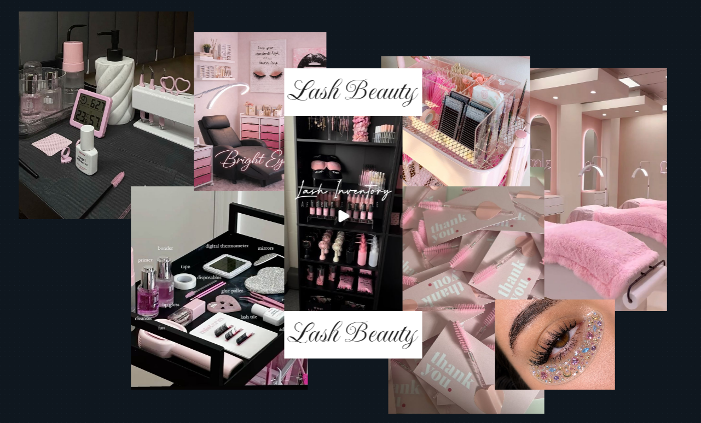

# Moodboard — [Nombre del emprendimiento]

> Guía: [Moodboard](../evaluacion/guias/fase-2-specs/02-moodboard.md)

**Tablero en Whimsical:** https://whimsical.com/duocuc91/Nv9J6dfGZdDFiaVf6qMvhW

 

## Palabras clave

## Qué sensación buscamos

<!-- 3 a 5 líneas: qué sensación y por qué conecta con tu proto-persona. -->
