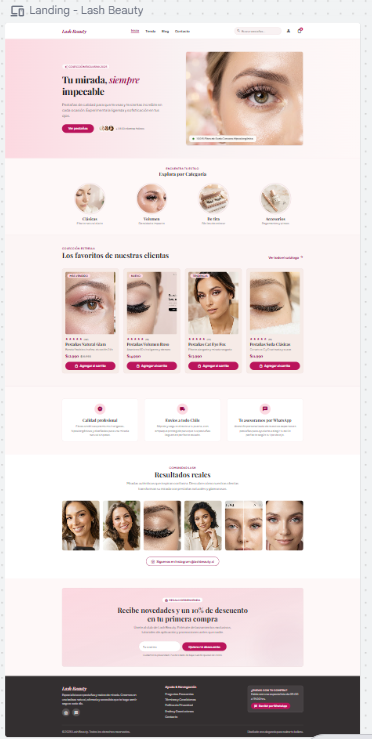
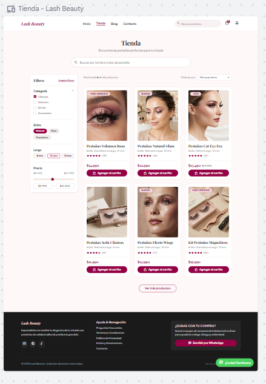

# QA — Lash Beauty

> Guía: [QA y coherencia](../evaluacion/guias/fase-3-prototipo/02-qa-y-coherencia.md)

## Prototipo en Stitch

> Guía: [Prototipo en Stitch](../evaluacion/guias/fase-3-prototipo/01-prototipo-en-stitch.md)

**Proyecto:** https://stitch.withgoogle.com/projects/9899201528685661057

| Pantalla | Desktop | Mobile |
|---|---|---|
| Landing |  | |
| Tienda |  | |
| Ficha de producto | | |
| Carrito | | |
| Blog | | |
| Artículo | | |

## Revisión: spec vs. prototipo

<!-- Una fila por diferencia. Resultado: ✅ / ❌ → ✅ / ❌ -->

| Pantalla | Qué dice la spec | Qué generó Stitch | Resultado | Corrección |
|---|---|---|---|---|
| | | | | |

## Mejoras a mis specs

no realice ningun cambio, la IA hizo bien las paginas acordes a lo que llevaba en mi avance
-

## User flows

| Flujo | Recorrido en el prototipo | ¿Se completa? |
|---|---|---|
| Compra | | |
| Contenido | | |

## Coherencia

<!-- 5 a 10 líneas: cómo responde el prototipo al brief y a tu proto-persona,
y qué cambió desde la Fase 1 y por qué. -->
