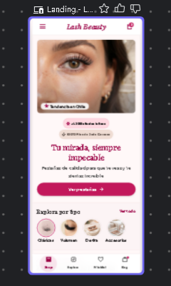
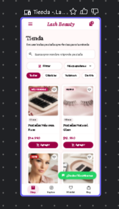
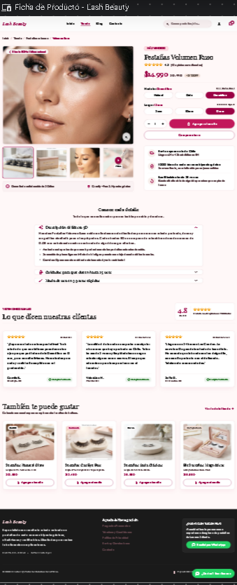
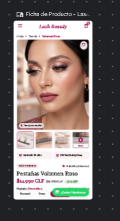
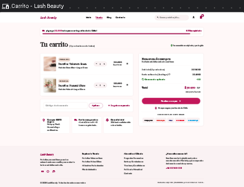
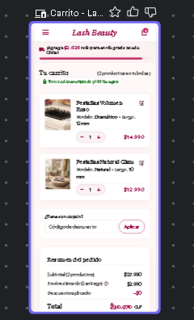
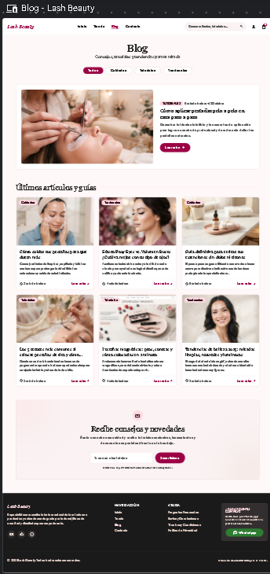
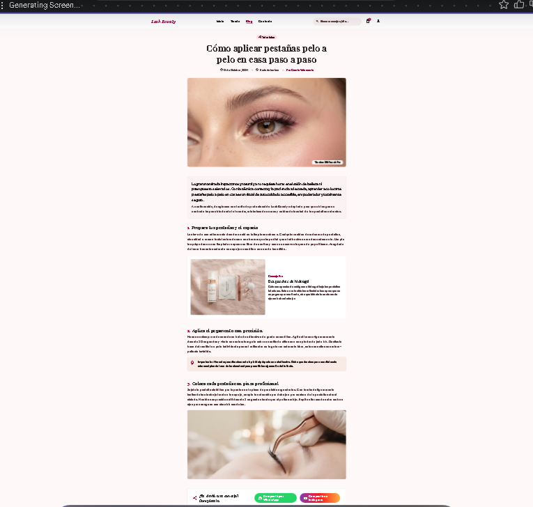
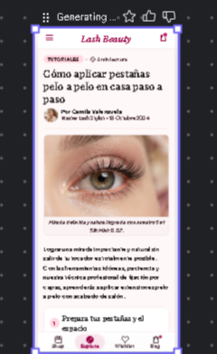

# QA — Lash Beauty

> Guía: [QA y coherencia](../evaluacion/guias/fase-3-prototipo/02-qa-y-coherencia.md)

## Prototipo en Stitch

> Guía: [Prototipo en Stitch](../evaluacion/guias/fase-3-prototipo/01-prototipo-en-stitch.md)

**Proyecto:** https://stitch.withgoogle.com/projects/9899201528685661057

| Pantalla | Desktop | Mobile |
|---|---|---|
| Landing |  |  |
| Tienda |  | |   |
| Ficha de producto | |  | 
| Carrito | |  |
| Blog | |  |
| Artículo |  |   |

## Revisión: spec vs. prototipo

<!-- Una fila por diferencia. Resultado: ✅ / ❌ → ✅ / ❌ -->

| Pantalla | Qué dice la spec | Qué generó Stitch | Resultado | Corrección |
|---|---|---|---|---|
| Landing | Navbar, imagen principal, categorías, destacados, beneficios, resultados, suscripción y footer | Incluye todos los bloques en el orden pedido | ✅ | Ninguna |
| Tienda | Buscador, filtros, 6 productos y botón "Ver más productos" | Cumple todo y agregó "Ordenar por", filtro de precio y etiquetas (Más vendido, Nuevo) | ✅ | Agregar esos extras a la spec |
| Ficha de producto | Tres secciones desplegables: "Descripción", "Cuidados" y "Modo de uso" | Cumple todo, pero les puso otros nombres ("Descripción del Efecto 3D", "Cuidados para que duren más tiempo", "Modo de uso y pasos rápidos") | ❌ → ✅ | Cambiar la spec a los nombres generados |
| Carrito | Mismo estilo que el resto de las pantallas | Cumple todo y agregó barra de envío gratis y medios de pago, pero el footer salió rosado claro y en las otras pantallas es oscuro | ❌ → ✅ | Pedir a Stitch el footer oscuro |
| Blog | Título, categorías, artículo destacado, 6 artículos, suscripción y footer | Cumple todo | ✅ | Ninguna |
| Artículo | Contenido, botones para compartir, producto relacionado, comentarios y "Sigue leyendo" | Cumple todo | ✅ | Ninguna |
| Landing mobile | Arriba: ícono de menú (tres rayitas), logo y carrito | Además puso una barra de botones abajo (Shop, Explore, Wishlist, Blog) que no estaba en la spec | ❌ → ✅ | Quitarla, o agregarla a la spec si decido dejarla |
| Blog mobile | Versión mobile del blog | La imagen existe, pero no se ve en el documento porque la ruta dice `blogmg.png` | ❌ → ✅ | Corregir la ruta a `img/blogmb.png` |
| Tienda mobile | Versión mobile de la tienda | La imagen existe, pero la celda sale vacía por separadores `\|` de más en la fila | ❌ → ✅ | Dejar solo 3 columnas en esa fila |

## Mejoras a mis specs

No cambié la estructura general, porque Stitch respetó el orden de los componentes en las 6 pantallas. Sí agregué detalles para que no dependan de lo que Stitch decida:

- **Mobile:** escribir que arriba solo van el ícono de menú, el logo y el carrito, sin barra de botones abajo.
- **Footer:** escribir "footer oscuro, igual en todas las pantallas".
- **Nombres exactos:** fijar los títulos de las secciones desplegables de la ficha.
- **Extras útiles que inventó Stitch:** incluir en la spec "Ordenar por", etiquetas de producto, barra de envío gratis y medios de pago, para que sean decisiones mías.
- **Pantalla que falta:** "Finalizar compra" no tiene pantalla de destino.

## User flows

| Flujo | Recorrido en el prototipo | ¿Se completa? |
|---|---|---|
| Compra | Landing → Tienda → Ficha de producto → "Agregar al carrito" → Carrito → "Finalizar compra" | ❌ Llega hasta el carrito. "Finalizar compra" no lleva a ninguna pantalla de pago ni de confirmación |
| Contenido | Landing → Blog → Artículo → producto relacionado "Comprar" → Carrito | ✅ Se completa de principio a fin |

## Coherencia

El prototipo responde bien al brief: comunica en segundos que Lash Beauty vende pestañas, con una imagen de mirada, categorías claras y productos destacados desde el primer vistazo. Para mi proto-persona Sofía, que busca rapidez y confianza, aparecen los elementos clave: buscador y filtros en la tienda, reseñas de 4,8 estrellas en la ficha, el mensaje "envíos a todo Chile", el botón de WhatsApp para resolver dudas y el blog para aprender a aplicar las pestañas. El estilo visual (rosa pastel, magenta y logo en cursiva) se mantiene en todas las pantallas, salvo el footer del carrito. Desde la Fase 1 no cambié la estructura de las pantallas. Ajusté detalles de consistencia (footer y mobile) y decidí qué extras generados por Stitch me sirven, porque mejoran la compra sin alejarse del brief.

## Mejoras a mis specs

No cambié la estructura general, porque Stitch respetó el orden de los componentes en las 6 pantallas. 

- **Mobile:** la spec mobile es una sola instrucción para todas las pantallas. Agregué que arriba solo lleve el ícono de menú, el logo y el carrito, y que no tenga barra de botones abajo.
- **Footer:** escribir "footer oscuro, igual en todas las pantallas".
- **Precios:** escribir "precios en pesos chilenos con formato $14.990, sin código de moneda".
- **Extras útiles que inventó Stitch:** incluir en la spec "Ordenar por", etiquetas de producto, barra de envío gratis y botón "Comprar ahora", para que sean decisiones mías.
- **Nombres exactos:** fijar los títulos de las secciones desplegables de la ficha.
- **Números que cuadren:** definir los precios del carrito para que Subtotal + Envío = Total.
- **Pantallas que faltan:** no hay spec para carrito vacío ni para tienda sin resultados.
- **Después de "Finalizar compra":** no existe pantalla de destino.

## User flows

| Flujo | Recorrido en el prototipo | ¿Se completa? |
|---|---|---|
| Compra | Landing ("Ver pestañas" o categorías) → Tienda → Ficha de producto → "Agregar al carrito" → Carrito | ✅ Sí, dentro del alcance definido (6 pantallas). Termina en el Carrito, que es la última pantalla de la spec. El pago y la confirmación quedan para una fase posterior |
| Contenido | Landing → Blog → Artículo → producto relacionado "Comprar" → Carrito | ✅ Sí, se completa de principio a fin |

## Coherencia

El prototipo responde bien al brief: comunica en segundos que Lash Beauty vende pestañas, con una imagen de mirada, categorías claras y productos destacados desde el primer vistazo. Para mi proto-persona Sofía, que busca rapidez y confianza, aparecen los elementos clave: buscador y filtros en la tienda, reseñas de 4,8 estrellas en la ficha, el mensaje "envíos a todo Chile", el botón de WhatsApp para resolver dudas y el blog para aprender a aplicar las pestañas. El estilo visual (rosa pastel, magenta y logo en cursiva) se mantiene en todas las pantallas, salvo el footer del carrito. Desde la Fase 1 no cambié la estructura de las pantallas. Ajusté detalles de consistencia (footer, mobile y moneda) y decidí qué extras generados por Stitch me sirven, porque mejoran la compra sin alejarse del brief.
